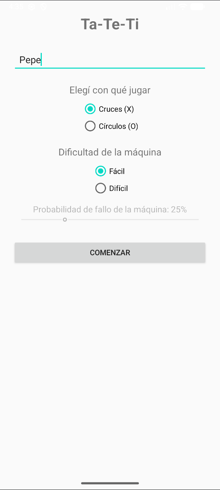
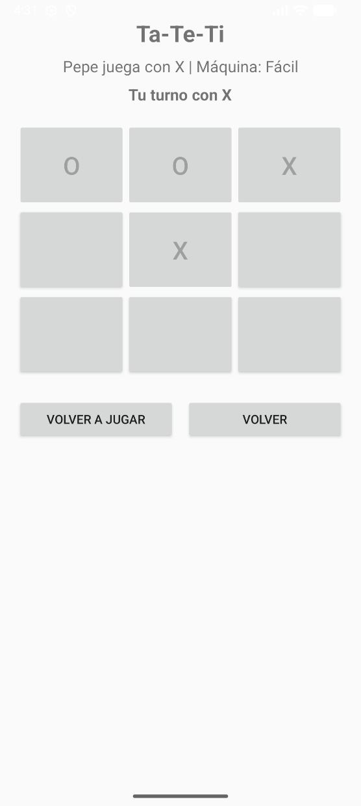
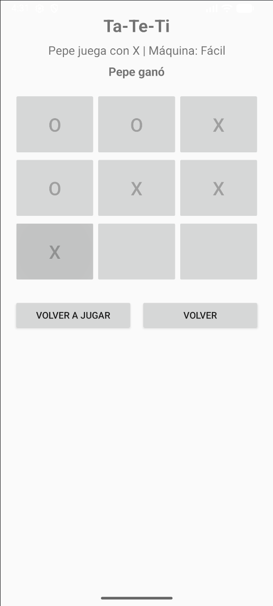

# Tic-Tac-Toe — Android App

Android implementation of Tic-Tac-Toe with configurable player settings and computer-controlled opponents.

The application allows the player to choose a symbol and difficulty level, while the hard mode uses a Minimax-based strategy with a configurable probability of making a non-optimal move.

## Features

- Player-name configuration
- X or O symbol selection
- Easy and hard difficulty levels
- Random-move AI in easy mode
- Minimax-based AI in hard mode
- Configurable AI mistake probability
- Random starting player
- Restart functionality
- Win, loss, and draw detection

## Screenshots

<table>
  <tr>
    <td align="center">
      <strong>Game Setup</strong>
    </td>
    <td align="center">
      <strong>Gameplay</strong>
    </td>
    <td align="center">
      <strong>Game Result</strong>
    </td>
  </tr>
  <tr>
    <td align="center">
      <a href="docs/screenshots/setup.webp">
        
      </a>
    </td>
    <td align="center">
      <a href="docs/screenshots/gameplay.webp">
        
      </a>
    </td>
    <td align="center">
      <a href="docs/screenshots/result.webp">
        
      </a>
    </td>
  </tr>
</table>

## Tech Stack

- Java
- Android SDK
- AndroidX
- Gradle
- XML layouts

## Requirements

- Android Studio
- JDK 17 or newer (JDK 21 tested)
- Android SDK 36
- Android 7.0 / API 24 or newer

## Running the Project

Open the project in Android Studio and run it using an emulator or Android device.

Alternatively:

```bash
./gradlew assembleDebug
```

On Windows:

```bash
gradlew.bat assembleDebug
```
